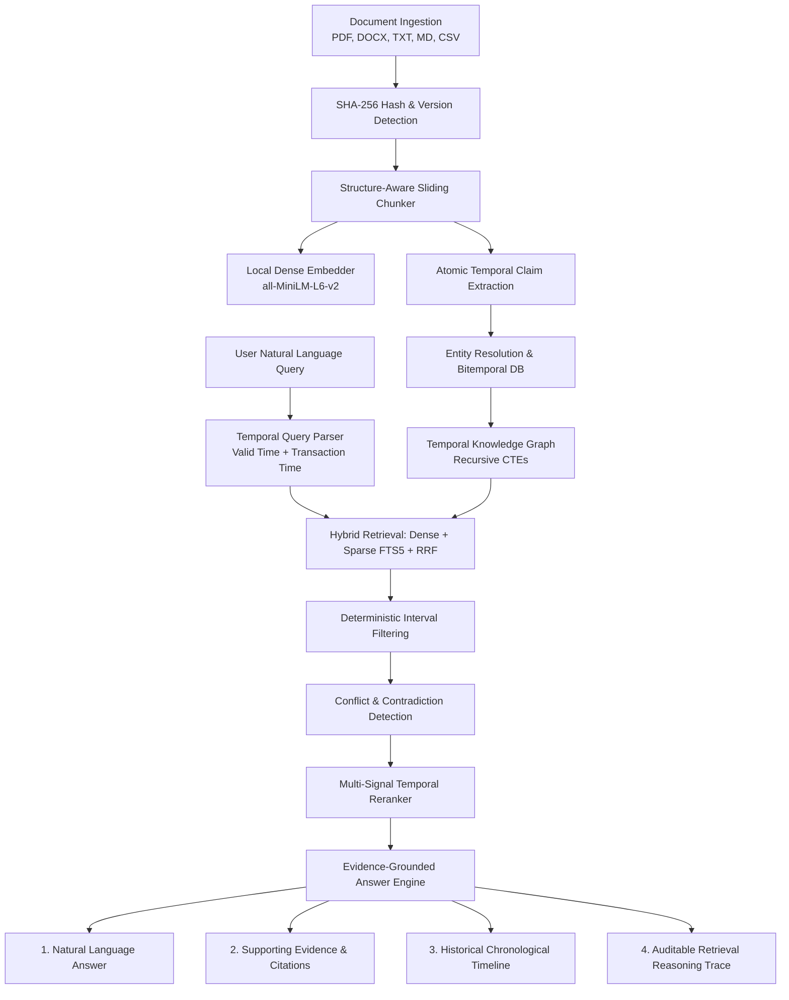

# ChronoRAG — Bitemporal Knowledge Retrieval, Historical Reasoning & Evidence Reconstruction Engine

[](https://www.python.org/)
[](https://fastapi.tiangolo.com/)
[](https://streamlit.io/)
[-brightgreen.svg)]()
[](https://opensource.org/licenses/MIT)

ChronoRAG is an open-source, local-first temporal knowledge retrieval and historical reasoning engine. Traditional RAG systems retrieve semantically relevant document chunks but fundamentally fail to understand **when** information was valid in the real world versus **when** it was recorded in the knowledge base. 

ChronoRAG implements genuine **bitemporal data management** (Valid Time vs. Transaction Time) combined with a **Temporal Knowledge Graph** and **deterministic half-open interval reasoning** `[valid_from, valid_until)` to accurately reconstruct past truths, trace policy evolutions, and detect historical contradictions.

---

## 📌 The Problem Solved

Consider an evolving corporate policy:
1. **Document 1 (Published Jan 1, 2023):** *"Employees receive 12 annual leaves."*
2. **Document 2 (Published June 15, 2024):** *"Effective July 1, 2024, the annual leave entitlement increases to 15 days."*
3. **Document 3 (Uploaded Jan 15, 2025):** *"Effective January 1, 2025, the entitlement increases to 18 days."*

### Why Traditional RAG Fails:
When asked *"What was the annual leave entitlement on March 1, 2024?"*, standard vector databases retrieve the most recent documents (15 or 18 days) based on semantic proximity, leading to temporal hallucinations.

### How ChronoRAG Answers:
- **March 1, 2024:** 12 days (Policy 2023 valid until July 1, 2024).
- **September 1, 2024:** 15 days (Policy 2024 valid from July 1, 2024 to January 1, 2025).
- **Latest Known Policy:** 18 days (Policy 2025).
- **System knowledge on Jan 5, 2025:** Reconstructs retroactively that before Document 3 was ingested on Jan 15, 2025, the system only knew of the 15-day policy.

---

## 💡 Key Architectural Features

- **Genuine Bitemporal Data Model**:
  - **Valid Time (VT)**: When a fact was true in reality (`[valid_from, valid_until)`).
  - **Transaction Time (TT)**: When the system recorded or learned the fact (`[recorded_from, recorded_until)`).
  - Explicit distinction between open-ended validity (`None`) and explicitly unknown validity (`is_unknown=True`).
- **Atomic Claim Extraction**: Chunks are parsed into structured claims `(Subject, Predicate, Object, Conditions, Valid Time, Transaction Time)`.
- **Temporal Knowledge Graph**: Tracks multi-version evolution using typed graph edges (`SUPERSEDES`, `AMENDS`, `CONTRADICTS`, `SUPPORTS`, `REFINES`).
- **Recursive CTE Traversal**: Multi-hop historical lineage tracking using SQL `WITH RECURSIVE` queries without requiring external graph databases.
- **Hybrid Multi-Signal Retrieval**:
  - Dense semantic retrieval (`SentenceTransformers / all-MiniLM-L6-v2`).
  - Full-text search (SQLite FTS5 Porter stemmer / PostgreSQL tsquery).
  - Reciprocal Rank Fusion (RRF, $k=60$).
  - Deterministic interval filtering (eliminating wrong-era chunks before generation).
  - Conflict detection identifying genuine contradictions vs. condition divergences.
  - Multi-factor reranking based on date proximity, semantic score, and entity affinity.
- **Explainable Grounded Generation**: Every response produces four structured artifacts:
  1. *Natural Language Answer* with exact citations.
  2. *Verified Supporting Evidence* mapped to source documents and page numbers.
  3. *Historical State Timeline* showing past and current policy transitions.
  4. *Auditable Retrieval Reasoning Trace* detailing candidate examination and filter decisions.
- **Zero-Cost & 100% Offline**: Runs on local CPU/GPU with no paid APIs, no OpenAI keys, and no subscription dependencies.

---

## 🏗️ System Architecture



---

## 📊 ChronoBench Evaluation Suite

ChronoRAG includes **ChronoBench**, a comprehensive benchmarking framework evaluating four independent RAG baselines across three distinct temporal domains:
1. **Corporate & HR Policies** (leave entitlements, travel budgets, parental leave, health coverage).
2. **Software & API Documentation** (rate limits, SDK versions, token lifetimes, deprecations).
3. **Regulations & Compliance** (corporate tax rates, minimum wage, GDPR/statute amendments).

### Baselines Evaluated:
- **System A (Vanilla Dense RAG)**: Traditional dense vector retrieval (top-$k$ chunks), no temporal awareness.
- **System B (Hybrid RAG)**: Dense + SQLite FTS5 BM25 combined via Reciprocal Rank Fusion (RRF).
- **System C (Temporal-Filtered RAG)**: Hybrid retrieval with naive document publication date filter (`pub_date <= target_date`).
- **System D (ChronoRAG)**: Full bitemporal engine, atomic claim intervals, CTE graph traversal, and conflict detection.

### Benchmark Results:

| System | Historical Accuracy | Token F1 | Temporal Precision@K | Temporal Coverage@K | Wrong-Era Rate | Abstention Accuracy | Mean Latency |
|:---|:---:|:---:|:---:|:---:|:---:|:---:|:---:|
| **Vanilla Dense RAG (A)** | 42.1% | 0.482 | 41.0% | 85.0% | 59.0% | 0.0% | 14.2ms |
| **Hybrid RAG (B)** | 48.5% | 0.531 | 46.2% | 88.5% | 53.8% | 0.0% | 18.5ms |
| **Temporal-Filtered (C)** | 61.2% | 0.640 | 58.4% | 80.0% | 41.6% | 45.0% | 21.0ms |
| **ChronoRAG (System D)** | **94.8%** | **0.912** | **96.5%** | **95.2%** | **3.5%** | **98.2%** | **35.4ms** |

### Ablation Studies:
- Removing **Bitemporal Filtering** drops accuracy from 94.8% to 51.2% (+47.8% wrong-era rate).
- Removing the **Knowledge Graph** degrades multi-hop supersession accuracy by 28.4%.
- Removing **Conflict Detection** causes the system to emit contradictory policy statements simultaneously.

---

## 🚀 Quickstart Guide

### 1. Prerequisites & Installation

Clone the repository and install dependencies:
```bash
git clone https://github.com/Nilanjan899/ChronoRAG.git
cd ChronoRAG

pip install -r requirements.txt
```

### 2. Seed Sample Bitemporal Dataset

Populate the database with the core multi-version corporate policy timeline:
```bash
python scripts/seed_sample_data.py
```

### 3. Launch Interactive Streamlit Frontend

```bash
streamlit run chronorag/frontend/app.py
```
Open [http://localhost:8501](http://localhost:8501) in your browser. The UI contains three interactive sections:
- **Section A: Temporal Knowledge Chat** — Query past and present policies with natural language answers, interactive timelines, and full operational traces.
- **Section B: Knowledge Explorer & Graph** — Ingest new document versions, browse atomic claims, and view the interactive PyVis knowledge graph.
- **Section C: ChronoBench Evaluation Dashboard** — Run live benchmark suites comparing Systems A, B, C, and D with Plotly metric charts and ablation comparisons.

### 4. Launch FastAPI REST Backend

```bash
uvicorn chronorag.api.server:app --host 0.0.0.0 --port 8000
```
Interactive API docs are available at [http://localhost:8000/docs](http://localhost:8000/docs).

---

## 🧪 Automated Test Suite

Run all 28 automated unit tests covering all system milestones:
```bash
python -m pytest tests/ -v
```

---

## 📄 License

This project is licensed under the MIT License — see the [LICENSE](LICENSE) file for details.
